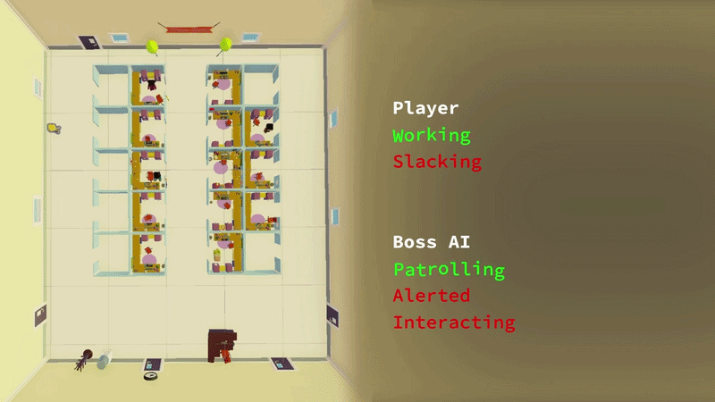

Hardly Workin' is a goofy office simulator game where you play as Buddy Inepta, a supreme slacker. You balance your work and fun in a goofy and chaotic office and have to avoid falling asleep on the job by slacking off. Just don't get caught by the BIG BOSS Karen...
## Trailer

[ Available for FREE on Steam!](https://store.steampowered.com/app/3724110/Hardly_Workin/)

---

> **Role:** Producer, Programmer
> **Team Size:** 7 total members, 3 programmers,  4 artists/designers
> **Duration:** 6 months  
> **Engine:** Unity  
> **Language:** C#  
> **Tools:** Git, P4 Plan (Hansoft)

## My Role
I was the **Producer** and a **Generalist Programmer** on *Hardly Workin'*, working across gameplay systems, AI, animation, and production management for a 7-person capstone team.
* Managed agile-style production, including sprint planning, task tracking, and weekly team check-ins
* Helped keep development priorities aligned across programming, art, and design
* Designed and implemented Boss and NPC AI using Finite State Machines (FSMs)
* Contributed to UI systems including menus and HUD implementation
* Integrated animation systems, VFX, and audio to support gameplay feedback and readability

## Challenges

### Designing Reactive NPC AI
One of the main technical challenges was building AI that felt responsive to the player while staying predictable enough for gameplay.

I implemented FSMs for both NPCs and the Boss character, allowing them to transition between states like patrol, alerted, and interaction in a structed way. This made the AI easier to tune and expand over time.

### Maintaining Scope and Development Focus
Another challenge was keeping the project scope under control as new ideas were added during development and playtesting.

As **Producer**, I helped prioritize tasks, organize sprint goals, and make sure the team stayed focused on the most important gameplay systems for each milestone. This helped keep development stable while still allowing room for iteration and polish.